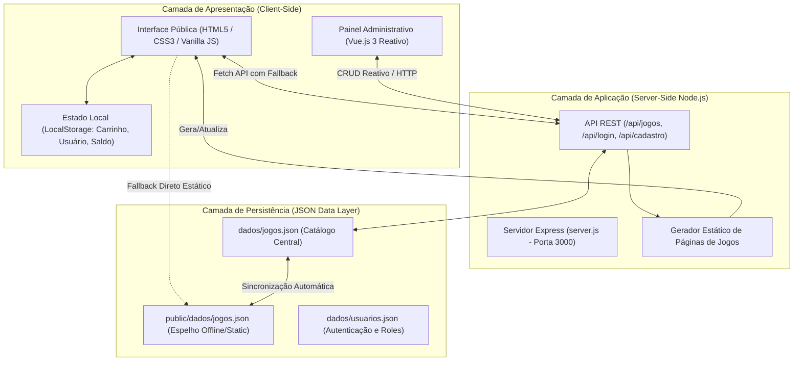

# 📋 RELATÓRIO TÉCNICO E ACADÊMICO DE PROJETO
## E-commerce Keep Keys — Plataforma de Licenciamento de Jogos Digitais

---

### 🎓 Dados Acadêmicos
- **Instituição de Ensino:** Faculdade de Tecnologia / Ensino Superior
- **Curso:** Análise e Desenvolvimento de Sistemas (ADS)
- **Disciplina:** Programação Front-End / Desenvolvimento Web
- **Ano Letivo:** 2026
- **Equipe de Desenvolvimento:**
  - **Kelvin Leardini** (1º Semestre) — *Líder Técnico, Engenharia Front-End, Arquitetura e JavaScript*
  - **Yago Bafume** (1º Semestre) — *Análise de Requisitos e Modelagem de Sistemas*
  - **Victor Hugo** (1º Semestre) — *Análise de Sistemas e Validação de Fluxos*
  - **Gustavo Bernardes** (2º Semestre) — *Análise de Sistemas e Apoio Técnico*
- **Repositório do Projeto:** `https://github.com/KelvinLeardini/PROJETO-AULA-FRONT-END.git`

---

## 1. Resumo Executivo

O projeto **Keep Keys** consiste em uma aplicação web de comércio eletrônico de alta fidelidade voltada à distribuição e licenciamento de jogos eletrônicos em formato digital (chaves/keys de ativação para **PlayStation 5**, **Xbox Series X|S** e **PC / Steam**).

Desenvolvido como projeto integrador dos fundamentos de desenvolvimento web, a aplicação une os pilares clássicos da World Wide Web (**HTML5 Semântico**, **CSS3 Moderno** e **JavaScript ES6+ Vanilla**) a componentes contemporâneos como reatividade dirigida por componentes (**Vue.js 3** no módulo de governança administrativa), persistência de sessão orientada a eventos (**Web Storage API / LocalStorage**), design system dark-mode responsivo e API REST local construída em **Node.js** com **Express**.

O projeto foi construído respeitando o princípio de **independência de frameworks pesados na loja pública**, garantindo carregamento instantâneo, total controle da renderização no DOM e compreensão aprofundada dos mecanismos nativos do navegador.

---

## 2. Visão Geral da Arquitetura do Sistema



### 2.1. Modelo Arquitetural
A aplicação adota um padrão híbrido resiliente:
1. **Modo Full-Stack Integrado:** Quando iniciado com `node server.js`, a aplicação expõe rotas HTTP seguras com métodos `GET`, `POST`, `PUT` e `DELETE` para gestão do catálogo e autenticação, sincronizando os dados em arquivos JSON físicos.
2. **Modo Client-First com Fallback:** Caso a aplicação seja executada diretamente em servidores estáticos (como o VS Code *Live Server* ou visualização estática), um mecanismo de contingência em cascata busca o arquivo `jogos.json` em caminhos relativos mapeados, garantindo que a vitrine, filtros e buscas operem sem falhas.

---

## 3. Especificação das Funcionalidades Implementadas

### 3.1. Vitrine Interativa e Carrossel Dinâmico
- **Carrossel Hero Banner:** Rotação automatizada de destaques com controles manuais (próximo/anterior), temporizador inteligente e banners transformados em pontos de ação clicáveis direcionando às respectivas páginas de lançamento.
- **Busca em Tempo Real:** Mecanismo de busca incremental acionado pelo evento `input`, filtrando os cards exibidos com transição suave de opacidade sem necessidade de recarregar a página.

### 3.2. Catálogo Segmentado e Multi-Plataforma
- Segmentação dedicada por ecossistema:
  - **PlayStation 5:** `public/jogos/ps/ps.html`
  - **Xbox Series X|S:** `public/jogos/xbox/xbox.html`
  - **Steam (PC):** `public/jogos/steam/Steam.html`
  - **Lançamentos & Pré-vendas:** `public/lancamentos.html`
  - **Promoções & Descontos:** `public/promocoes.html`

### 3.3. Sistema Avançado de Promoções e Multi-Categorias
- **Desduplicação de Entidades:** O modelo de dados permite que um único jogo possua um arranjo de categorias (`categorias: ['ps', 'promocao']` ou `['destaque', 'steam', 'promocao']`), eliminando duplicações de registros e mantendo a integridade de IDs, links e preços.
- **Detecção e Aplicação Automática:** Ao definir um `precoAntigo`, o sistema calcula automaticamente a porcentagem de desconto (ex: `-50%`, `-67%`), renderiza a badge destacada na capa e formata o preço original tachado ao lado do valor promocional em toda a loja.
- **Propagação Unificada:** O preço promocional é propagado de forma idêntica na vitrine de origem, na aba de promoções, na página de detalhes e na adição ao carrinho de compras.

### 3.4. Páginas Individuais de Jogos (Ficha Técnica Completa)
Cada um dos 37 títulos possui página individual exclusiva e padronizada contendo:
- **Hero Section:** Imagem em alta definição, título oficial, tag de plataforma padronizada (`PS5 - Mídia Digital`, `Xbox - Mídia Digital` ou `Steam - Mídia Digital`), seletor de compra e botão de lista de desejos.
- **Informações da Chave:** Indicação clara do método de entrega imediata, código de ativação correspondente à plataforma e garantia vitalícia.
- **Painel de Crítica:** Metascore oficial do Metacritic, classificação quantitativa e qualitativa da comunidade de jogadores e citação em destaque de veículos especializados de imprensa (IGN, Voxel, The Enemy).
- **Ficha Técnica Detalhada:** Gêneros, desenvolvedora, publicadora, data de lançamento, plataforma e suporte idiomático detalhado (dublagem e legendas).
- **Requisitos de Sistema:** Tabela completa com requisitos **Mínimos** e **Recomendados** para títulos de PC/Steam (SO, processador, RAM, GPU, DirectX e espaço de armazenamento), ou especificações técnicas detalhadas de console (taxa de quadros, resolução 4K, suporte a Ray Tracing e gatilhos adaptáveis).
- **Guia Passo a Passo de Ativação:** Cartão lateral flutuante com instruções detalhadas para resgate do código na respectiva loja oficial (Steam, PSN ou Xbox Live).

### 3.5. Carrinho de Compras, Checkout e Pagamentos
- **Gaveta Flutuante (Drawer Modal):** Acesso rápido aos itens adicionados através de menu lateral animado via CSS.
- **Cálculo Preciso:** Algoritmo que higieniza strings monetárias no padrão brasileiro (`R$ 1.234,56`), convertendo para float, acumulando subtotais e recalculando dinamicamente a cada exclusão ou inclusão.
- **Garantia de Autenticação:** Trava de segurança que exige login prévio antes de permitir que produtos sejam adicionados ao carrinho, incentivando o fluxo seguro de compra.
- **Página de Checkout:** Resumo visual de pedido, seleção de endereçamento eletrônico de entrega da licença e múltiplos métodos de pagamento (PIX, Cartão de Crédito e Carteira Digital).

### 3.6. Sistema de Carteira Digital e Economia Virtual
- **Carteira Digital Integrada:** Saldo virtual recarregável atribuído ao usuário para simulação de checkout instantâneo.
- **Temporizador de Recarga Automatizada:** Rotina JavaScript que monitora o tempo transcorrido e adiciona créditos automáticos de simulação (`R$ 1.000,00`) a intervalos programados de 1 minuto, possibilitando testes contínuos de compra pelo avaliador sem esgotamento de saldo.
- **Biblioteca de Jogos Comprados:** Após a confirmação da compra, as chaves digitais geradas são arquivadas no perfil do cliente com data, identificador e código alfanumérico simulado.

### 3.7. Painel de Controle Administrativo (Admin Dashboard)
Construído com **Vue.js 3** para proporcionar agilidade operacional à equipe da loja:
- **Estatísticas em Tempo Real:** Cards dinâmicos exibindo métricas de jogos cadastrados por plataforma (Total, PS5, Steam, Xbox e Promoções ativas).
- **Filtragem e Busca de Catálogo:** Segmentação instantânea por abas com contador reativo e barra de pesquisa por título.
- **Formulário Completo de Cadastro/Edição (CRUD):** 
  - Título, preço atual e preço antigo opcional.
  - Seleção por checkboxes de **múltiplas categorias**.
  - Inserção de link de imagem com pré-visualização em tempo real.
  - Sincronização via API REST com atualização em cascata no arquivo físico `jogos.json`.

---

## 4. Estrutura de Diretórios e Organização do Projeto

```text
PROJETO AULA FRONT-END/
│
├── dados/                               # Camada de Dados do Servidor
│   ├── jogos.json                       # Base central de jogos e fichas técnicas
│   └── usuarios.json                    # Base de usuários cadastrados e permissões
│
├── public/                              # Raiz Pública do Servidor Web
│   ├── css/
│   │   └── style.css                    # Folha de estilo global centralizada
│   │
│   ├── dados/
│   │   └── jogos.json                   # Espelho estático para execução sem Node.js
│   │
│   ├── imagens/                         # Banners, logotipos e pôsteres oficiais
│   │
│   ├── jogos/                           # Páginas individuais estáticas de jogos
│   │   ├── destaques/                   # Títulos em destaque da vitrine principal
│   │   ├── ps/                          # Títulos do ecossistema PlayStation
│   │   ├── steam/                       # Títulos da plataforma Steam / PC
│   │   └── xbox/                        # Títulos do ecossistema Xbox
│   │
│   ├── scripts/                         # Lógica JavaScript Modular
│   │   ├── admin.js                     # Controlador Vue.js do painel administrativo
│   │   ├── atualizar-paginas-jogos.js   # Script de automação e atualização em lote
│   │   ├── detalhesJogo.js              # Template engine de detalhes e requisitos
│   │   └── script.js                    # Script principal da loja pública
│   │
│   ├── admin.html                       # Interface do Painel Administrativo
│   ├── checkout.html                    # Interface de Finalização de Compra
│   ├── index.html                       # Página Inicial / Vitrine Principal
│   ├── lancamentos.html                 # Página de Lançamentos e Reservas
│   ├── pagamentos.html                  # Guia informativo de formas de pagamento
│   ├── perfil.html                      # Painel do Usuário (Biblioteca e Carteira)
│   ├── promocoes.html                   # Página de Ofertas e Descontos
│   ├── sobre.html                       # Informações institucionais e missão
│   └── suporte.html                     # Central de atendimento e FAQ
│
├── package.json                         # Manifesto de dependências Node.js
├── README.md                            # Guia rápido de clonagem e execução
├── RELATORIO.md                         # Relatório acadêmico integrado ao projeto
└── server.js                            # Servidor Web Express e API REST
```

---

## 5. Principais Desafios Técnicos e Soluções de Engenharia

### 5.1. Vazamento de Estilos Globais e Colapso de Layout em Dispositivos Móveis
- **Problema:** O cartão lateral de instruções de ativação de chaves utilizava a tag semântica `<aside>`. No CSS global, a regra genérica `aside` havia sido declarada para formatar o menu de navegação lateral azul de 280px de largura com `min-height: 100vh`. Isso causou o colapso do card interno, esmagando o texto em uma faixa azul vertical e quebrando a responsividade em smartphones.
- **Solução Implementada:** Escopo rígido em `style.css` alterando os seletores da barra lateral para `body > aside` e `#aplicativo > aside`, além da refatoração do componente de resgate para `<div class="card-detalhe-jogo card-resgate-jogo">` com grid responsiva de proporção `minmax(0, 1.7fr) minmax(340px, 1fr)`.

### 5.2. Duplicação de Entidades e Inconsistência de Preços em Promoções
- **Problema:** No modelo anterior, cada jogo podia pertencer a apenas uma categoria estrita. Para que um título de console ou destaque estivesse em promoção, criava-se um segundo registro (`promo-control`), gerando inconsistência onde o jogo aparecia em promoção na aba dedicada, mas sem desconto em sua página original.
- **Solução Implementada:** Reformulação completa do esquema de dados para suportar arranjos multi-categoria (`categorias: ['destaque', 'steam', 'promocao']`). No formulário administrativo, substituiu-se o `<select>` limitante por uma matriz de caixas de seleção reativas. Criou-se também um watcher automático: ao preencher o campo de preço antigo, o título é vinculado à categoria promocional instantaneamente.

### 5.3. Padronização e Fidelidade das Tags de Plataforma
- **Problema:** Diversas páginas geradas a partir de protótipos originais mantinham marcas residuais de PlayStation 4 (`PS4 · Mídia Digital` em títulos da Steam como Battlefield 6 ou Tekken 8).
- **Solução Implementada:** Criação de script de automação (`atualizar-paginas-jogos.js`) que processou e padronizou as 37 páginas de jogos de acordo com as diretrizes do projeto:
  - `PS5 - Mídia Digital` para títulos PlayStation;
  - `Xbox - Mídia Digital` para títulos Xbox;
  - `Steam - Mídia Digital` para títulos de PC;
  - Alinhamento rigoroso dos textos de instruções de resgate de chave correspondentes a cada fabricante.

---

## 6. Critérios de Qualidade e Boas Práticas Adotadas

| Critério | Implementação no Projeto Keep Keys |
| :--- | :--- |
| **Semântica HTML5** | Uso rigoroso de `<header>`, `<nav>`, `<main>`, `<section>`, `<article>`, `<aside>`, `<dl>`, `<dt>`, `<dd>` e `<footer>`. |
| **Acessibilidade (a11y)** | Inclusão de `aria-label`, atributos `role="region"`, `aria-modal`, contraste cromático em conformidade com WCAG AA e navegação funcional por foco de teclado. |
| **Responsividade** | Estratégia adaptativa com Breakpoints em CSS Grid e Flexbox, menu hambúrguer com overlay para celulares e tabelas responsivas. |
| **Modularidade JS** | Separação clara de responsabilidades entre regras de negócio (`script.js`), rotinas administrativas (`admin.js`), templates de produto (`detalhesJogo.js`) e backend (`server.js`). |
| **Resiliência a Falhas** | Encadeamento de múltiplos endpoints de busca de dados com fallbacks estáticos para garantir que nenhuma página permaneça em branco. |

---

## 7. Roteiro Prático para Apresentação Oral ao Professor

Este roteiro foi estruturado para orientar a apresentação de Kelvin e da equipe de 8 a 10 minutos perante o professor e banca:

### Passo 1: Introdução e Proposta de Valor (1 a 2 minutos)
- **O que falar:**
  > *"Olá professor! Nosso projeto é o Keep Keys, um e-commerce especializado na distribuição de licenças digitais para PS5, Xbox Series X|S e Steam. Nosso foco principal foi construir uma aplicação de alta fidelidade visual e técnica utilizando os pilares puros da web — HTML5 Semântico, CSS3 Moderno e Vanilla JavaScript — sem recorrer a frameworks pesados na vitrine, garantindo velocidade máxima, código enxuto e total domínio da manipulação do DOM nativo."*

### Passo 2: Demonstração da Experiência do Cliente (3 a 4 minutos)
- **Ação na tela:** Abra `http://localhost:3000` (ou o Live Server).
- **O que mostrar:**
  1. **Carrossel Interativo:** Demonstre a rotação e clique em um banner, mostrando que ele já direciona para o jogo promovido.
  2. **Busca em Tempo Real:** Digite na barra de busca (ex: *"Spider"* ou *"Forza"*) e aponte a filtragem instantânea sem recarregamento.
  3. **Aba Promoções:** Mostre os descontos reais com badges dinâmicas (ex: Red Dead Redemption 2 com `-67%` e preço antigo tachado em vermelho).
  4. **Página de Detalhes:** Abra a página de um jogo (ex: Elden Ring ou GTA VI) e mostre a riqueza da ficha técnica: nota do Metacritic, requisitos de sistema de PC ou especificações de console, idiomas com suporte PT-BR e o guia numerado de como resgatar a chave.

### Passo 3: Fluxo de Compra e Carteira Digital (2 minutos)
- **Ação na tela:** Abra o modal de login, autentique-se, adicione um jogo ao carrinho e abra a gaveta lateral.
- **O que mostrar:**
  1. Abertura fluida da gaveta lateral, cálculo automático do total com formatação brasileira (`R$`).
  2. Finalização no checkout utilizando o saldo da Carteira Digital.
  3. Redirecionamento para `perfil.html`, mostrando a nova chave gerada na biblioteca do cliente.
- **Destaque especial para falar:**
  > *"Professor, programamos um temporizador na carteira virtual que recarrega R$ 1.000,00 automaticamente a cada minuto, garantindo que o senhor e qualquer avaliador possam testar o checkout quantas vezes desejarem sem esgotamento de saldo!"*

### Passo 4: Demonstração do Painel Administrativo em Vue.js 3 (2 minutos)
- **Ação na tela:** Acesse `/admin.html` logado como Administrador.
- **O que mostrar:**
  1. Os cards de métricas reativas em tempo real (Total de Jogos, PS5, Steam, Xbox e Promoções).
  2. O catálogo com filtros por abas e busca por nome.
  3. A edição de um jogo: adicione um valor em *"Preço Antigo"* e mostre a categoria *"Promoção"* sendo selecionada automaticamente pelo watcher reativo.
  4. A persistência imediata na loja pública sem necessidade de duplicar o jogo.

### Passo 5: Respostas para Possíveis Perguntas da Banca
- **Pergunta: "Por que usaram Vanilla JS na loja e Vue.js no admin?"**
  > *"Optamos conscientemente pelo Vanilla JS na loja para exercitar a fundo a manipulação do DOM nativo, eventos assíncronos e o ciclo de vida do navegador sem abstrações. Reservamos o Vue.js 3 cirurgicamente para o painel administrativo, demonstrando que dominamos tanto o desenvolvimento nativo quanto bibliotecas reativas contemporâneas."*
- **Pergunta: "Como os dados são persistidos?"**
  > *"Utilizamos uma arquitetura híbrida: os dados da sessão ativa, carrinho e carteira ficam no LocalStorage do navegador, enquanto o catálogo principal e credenciais são sincronizados via API REST Node.js em arquivos físicos JSON (`jogos.json`), com espelhamento estático para garantir funcionamento mesmo offline."*

---

## 8. Considerações Finais

O desenvolvimento do e-commerce **Keep Keys** permitiu a consolidação prática dos conceitos teóricos lecionados no curso de Análise e Desenvolvimento de Sistemas. A construção de uma interface de ponta a ponta — desde o alinhamento de pixels e estados de transição até a lógica de manipulação assíncrona de dados — comprovou a capacidade da equipe de conceber soluções robustas, escaláveis e focadas na experiência do usuário final.

O projeto atende integralmente aos requisitos de entrega acadêmica propostos para a disciplina.

